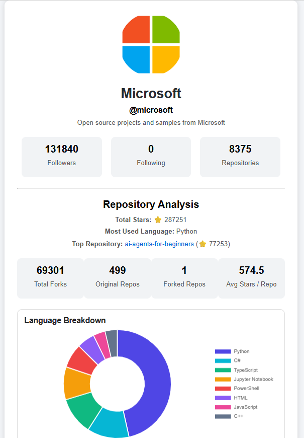
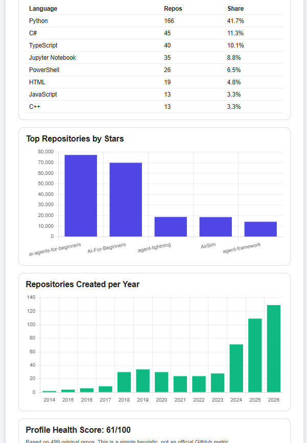
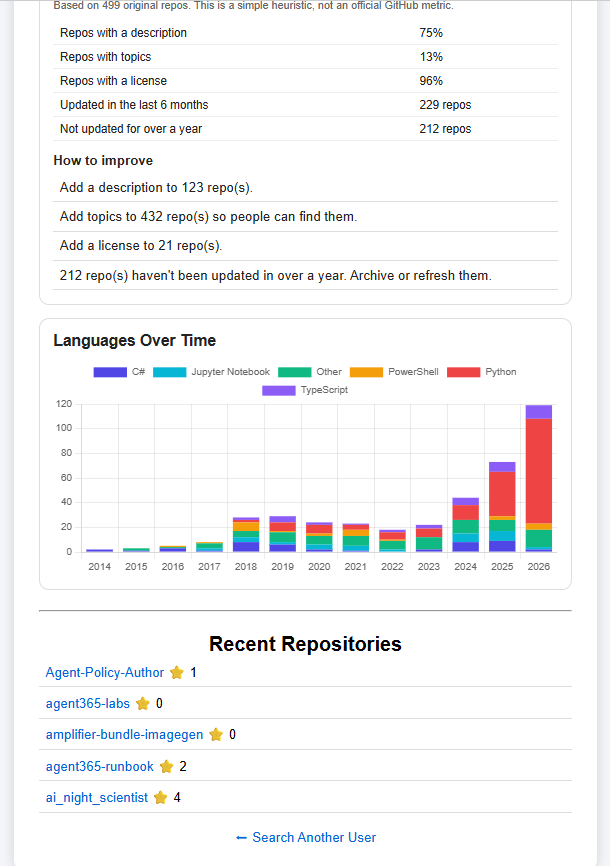
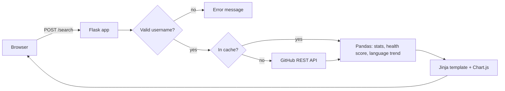

# GitHub Repository Analyzer


A Flask web app that analyzes any public GitHub profile. It turns a user's repositories into statistics, charts and a profile health report with tips on how to improve.

**Live demo:** https://github-repo-analyzer-cplx.onrender.com
*(Hosted on Render's free tier, so the first load after idle can take up to a minute.)*







## Features

- Search any public GitHub username
- Profile summary: avatar, bio, followers, following, repository count
- Statistics computed with **Pandas**: total stars, forks, original vs forked repos, average stars per repo
- **Charts** (Chart.js): language breakdown, top repositories by stars, repositories created per year
- **Languages over time:** a stacked chart showing how a user's language mix changed year by year
- **Profile health score:** checks descriptions, topics, licenses and recent activity, then lists concrete tips to improve the profile
- Reads all of a user's repos (paginated, up to 500), not just the first 30
- Clear error messages for unknown users, invalid usernames, rate limits and network problems

## How it works



## Design decisions

- **Pagination:** GitHub returns 30 repos per request by default, which gives wrong totals for larger accounts. The app fetches 100 per page across several pages.
- **Caching:** results are cached in memory for 10 minutes to cut API calls and stay within GitHub's rate limit.
- **Input validation:** usernames are checked against GitHub's allowed format before they are used in an API URL.
- **Error handling:** timeouts on every request, and readable messages for 404, rate limits and network failures.
- **Optional token:** if `GITHUB_TOKEN` is set, requests use it for a higher rate limit (5,000 per hour instead of 60). If the token is rejected, the app falls back to unauthenticated requests instead of failing.
- **Health score:** a simple heuristic (descriptions 30%, recent activity 25%, topics 20%, licenses 15%, number of projects 10%) based on a user's own, non-forked repos. It is not an official GitHub metric.

## Tech stack

Python, Flask, Pandas, Requests, Chart.js, Jinja2, pytest, GitHub Actions, gunicorn, Render.

## Run locally

```bash
git clone https://github.com/Amulya012005/Github-Repository-Analyser.git
cd Github-Repository-Analyser
python -m venv venv
venv\Scripts\activate        # Windows (use: source venv/bin/activate on Mac/Linux)
pip install -r requirements-dev.txt
python app.py                # http://localhost:5000
```

Optional: create a `.env` file with `GITHUB_TOKEN=your_token` (a fine-grained token with read-only access to public repositories is enough).

## Tests and CI

```bash
python -m pytest -q
```

11 tests cover input validation, error mapping (404 and rate limits), pagination, caching, the analytics calculations, the health score and the language trend. GitHub Actions runs them on every push, using a mocked GitHub API so no network is needed.

## Known limitations and next steps

- The cache is in memory, so it resets on restart and isn't shared between servers. Next step: Redis.
- Only the first 500 repos per user are analyzed.
- Commit and contributor statistics would need extra API calls per repository.
- Compare two users side by side.